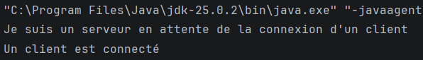
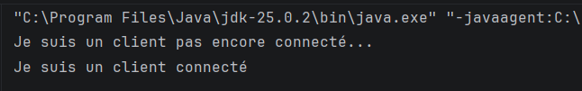
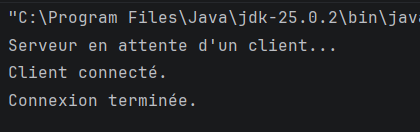
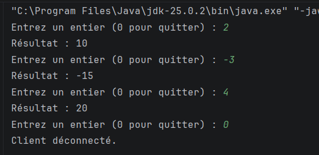
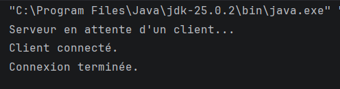
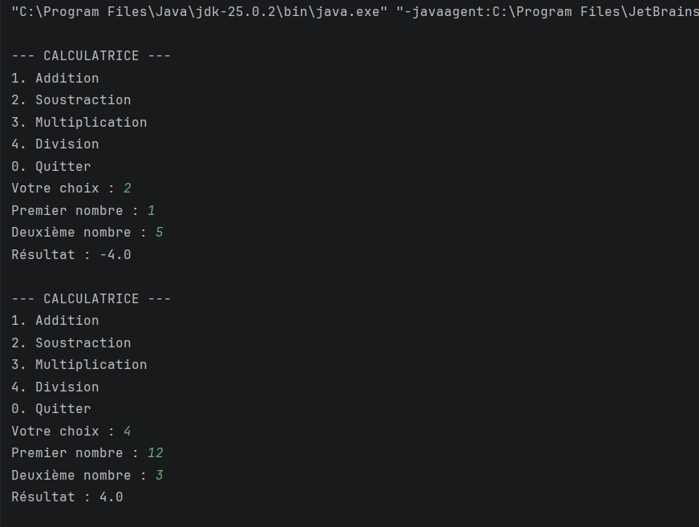

# TP1-DAR2026
## Développement d'applications réparties

**Étudiante :** Gharbi Yesmine  
**Dépôt GitHub :** https://github.com/yesmine-gharbi/TP1-DAR2026

---

## Objectifs du TP

- Comprendre la communication entre un client et un serveur en Java.
- Utiliser les sockets TCP.
- Échanger des données entre deux applications Java.
- Développer un service de multiplication puis une calculatrice.
- Tester la communication entre deux machines sur un réseau local.

---

## Activité 1-1 : Première connexion Client/Serveur

### Objectif

Créer un serveur et un client Java capables d'établir une connexion TCP sur le port 5000.

### Classes utilisées

- `serverPackage.Server` : crée le serveur et attend la connexion d'un client.
- `clientPackage.Client` : se connecte au serveur.

### Fonctionnement

1. Le serveur démarre et attend une connexion.
2. Le client se connecte au serveur.
3. Le serveur affiche un message confirmant la connexion.
4. Le client et le serveur ferment la connexion.

### Captures d'écran

**Console du serveur :**



**Console du client :**



---

## Activité 1-2 : Service de multiplication par 5

### Objectif

Permettre au client d'envoyer un entier au serveur. Le serveur multiplie cet entier par 5 et renvoie le résultat au client.

### Fonctionnement

1. Le client saisit un entier.
2. Le client envoie cet entier au serveur.
3. Le serveur calcule le produit par 5.
4. Le serveur renvoie le résultat au client.
5. La communication continue jusqu'à ce que le client saisisse `0`.

### Classes utilisées

- `serverPackage.Server`
- `clientPackage.Client`

### Tests

| Valeur saisie | Résultat attendu |
|---:|---:|
| 2 | 10 |
| -3 | -15 |
| 4 | 20 |
| 0 | Fin de la communication |

### Captures d'écran

**Console du serveur :**



**Console du client :**



---

## Activité 1-3 : Calculatrice Client/Serveur

### Objectif

Développer une calculatrice permettant au client de demander au serveur d'effectuer des opérations mathématiques.

### Opérations disponibles

- Addition
- Soustraction
- Multiplication
- Division

### Fonctionnement

1. Le serveur attend la connexion d'un client.
2. Le client affiche un menu proposant les quatre opérations.
3. Le client choisit une opération et saisit deux nombres.
4. Le client envoie le choix et les nombres au serveur.
5. Le serveur effectue le calcul et renvoie le résultat.
6. Le client affiche le résultat.
7. Le programme continue jusqu'à ce que le client choisisse `0`.

### Gestion des erreurs

La division par zéro est détectée et un message d'erreur est envoyé au client.

### Tests

| Opération | Premier nombre | Deuxième nombre | Résultat attendu |
|---|---:|---:|---|
| Addition | 8 | 2 | 10 |
| Soustraction | 8 | 2 | 6 |
| Multiplication | 8 | 2 | 16 |
| Division | 8 | 2 | 4 |
| Division | 8 | 0 | Message d'erreur |

### Captures d'écran

**Console du serveur :**



**Console du client :**



---

## Communication sur le réseau local

Le client peut se connecter au serveur depuis une autre machine connectée au même réseau local.

Pour cela :
- Le serveur écoute sur le port 5000.
- L'adresse IP réelle du serveur doit être utilisée dans le client.
- Le pare-feu doit autoriser la connexion si nécessaire.

Exemple de connexion dans le client :

```java
Socket socket = new Socket("ADRESSE_IP_DU_SERVEUR", 5000);
```

L'adresse doit être remplacée par l'adresse IPv4 réelle de l'ordinateur serveur.

---

## Technologies utilisées

- Java
- Sockets TCP
- `ServerSocket`
- `Socket`
- `DataInputStream`
- `DataOutputStream`
- Git
- GitHub
- IntelliJ IDEA

---

## Conclusion

Ce TP permet de comprendre les bases de la communication entre applications Java à l'aide des sockets TCP. Les activités réalisées permettent de créer une connexion client/serveur, d'échanger des données, de développer un service de multiplication et de mettre en place une calculatrice distribuée.

---

## Dépôt GitHub

Lien du projet : https://github.com/yesmine-gharbi/TP1-DAR2026
